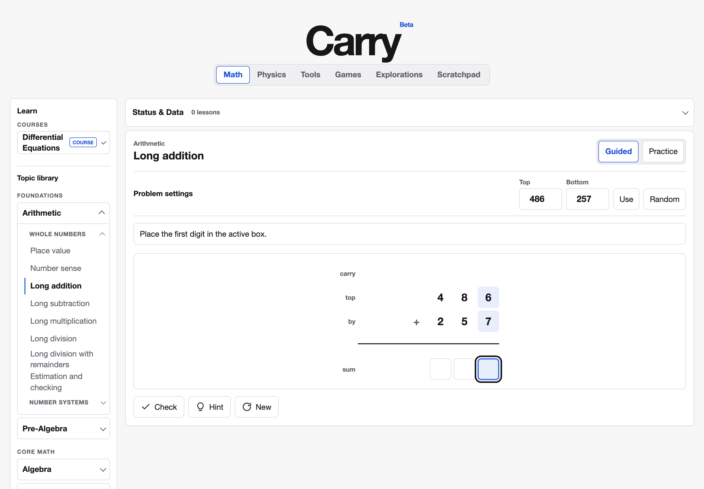

# Carry

Version: `0.1.0-beta.52`

Carry is a local-first learning studio for mathematics and physics. It runs entirely in the browser and opens directly into a focused activity.

The project began as a way to resume mathematics after a long break, including foundations such as long division. It now connects low-friction refreshers with advanced topics, visual tools, games, and deeper university-level courses.



## Learning Experience

- **Guided work** presents one small action at a time with immediate feedback and optional hints.
- **Practice** reduces scaffolding and lets learners complete procedural work more freely.
- **Interactive notation** uses semantic digit grids, equation rows, matrices, diagrams, graphs, and MathML instead of treating every problem as a text box.
- **No time pressure** means hints remain available without penalties, streaks, or opaque mastery scores.
- **Keyboard and pointer support** keeps common workflows usable without paper or a mouse.

Concept lessons use direct answer choices or focused typed responses. Procedural lessons provide purpose-built workspaces for long arithmetic, equation transformations, factoring, differential equations, and matrix operations.

## Curriculum

The Topic library spans foundational through advanced undergraduate mathematics:

- Arithmetic and Pre-Algebra
- Algebra, Geometry, Trigonometry, and Precalculus
- Calculus and Differential Equations
- Linear Algebra and Complex Analysis
- Probability and Statistics
- Proofs, Set Theory, Number Theory, and Graph Theory
- Real Analysis, Topology, and Abstract Algebra

Physics lessons cover measurement, mechanics, waves, electricity and magnetism, thermodynamics, quantum ideas, and relativity.

Differential Equations is Carry's first sequenced university-level course. Its thirteen lessons cover first- and second-order equations, systems, Laplace transforms, and series solutions.

Guided symbolic work is paired with slope fields, Euler approximation, and phase lines.

## Beyond Lessons

**Carry Scratchpad** turns plain text or LaTeX-like input into readable mathematics. It supports aligned work, local autosave, Undo and Redo, line duplication, and export to text, LaTeX, Markdown, or SVG.

**Carry Grapher** provides movable 2D and 3D graphs. Other tools cover random values, normal simulations, the unit circle, complex coordinates, prime factors, and greatest common divisors.

**Games** include generated Sudoku, modular arithmetic, divisibility, prime factors, residues, graph paths, and graph coloring. **Explorations** present dated, think-first puzzles with optional interactive responses.

**Lesson Studio** compiles data-only Carry Lesson Specification (CLS) files into temporary custom lessons. It includes validation, local history, and an immersive lesson runner.

Authors can use a repo-aware Codex task or a self-contained ChatGPT handoff.

## Local First

Carry does not use accounts, email addresses, passwords, or server-side learner profiles.

Progress, capability evidence, scratchpads, games, tool settings, and Lesson Studio history are stored in the current browser. **Status & Data** can export everything to one JSON backup and import it later.

Custom Lesson Studio sessions run in memory and do not alter curriculum progress. Pasted lesson data cannot execute JavaScript or inject authored HTML, SVG, or MathML.

## Routes

Lessons and tools have readable URLs, including:

- `/math/arithmetic/long-addition`
- `/math/differential-equations/separable-equations`
- `/math/statistics/normal-distribution`
- `/physics/thermodynamics/ideal-gas-law`
- `/scratchpad`
- `/tools/graphing`
- `/tools/lesson-builder`
- `/games/sudoku`

Static hosts must rewrite unknown application paths to `index.html`.

## Run Locally

Carry has no production build step. Open `index.html` directly or serve the repository with a static file server.

Install the browser QA dependency once:

```sh
npm install
npx playwright install chromium
```

Run the complete automated gate:

```sh
npm run check
```

Useful narrower checks:

```sh
npm run test:unit
npm run test:e2e
npm run test:qa
```

## Lesson Authoring

CLS is a constrained, versioned lesson format rather than a general programming language. It can use only reviewed interaction engines, response types, figures, capabilities, and transformations from the catalog.

Key locations:

- `authoring/README.md`: authoring contract and AI guidance
- `authoring/schema/`: JSON Schema
- `authoring/catalogs/`: supported capabilities
- `authoring/examples/`: reference lessons
- `authoring/lessons/`: production CLS lessons
- `core/lesson-spec.js`: validator and compiler

Validate a temporary custom lesson:

```sh
npm run lesson:validate -- /tmp/carry-custom-lesson.carry.json
```

After changing a production `.carry.json` file:

```sh
npm run lessons:compile
npm run lessons:check
```

Generated lesson output is committed so production remains build-free.

For portable courses, see the [Carry Education Specification](education-spec/README.md). This independent draft includes a validator, an offline reader, and example courses with reusable YAML or JSON question banks.

### Carry Education Kit

[Download the Carry Education Kit (ZIP)](https://raw.githubusercontent.com/iandorsey00/carry/main/downloads/carry-education-kit-0.1.0.zip). It includes the authoring tools, public examples, and guides in English and Simplified Chinese.

Extract the ZIP and run these commands from the extracted `education-spec` folder with Node.js and npm installed:

```sh
npm ci
npm run read -- examples/astronomy astronomy.html
```

Open `astronomy.html` in your browser. Finished courses are self-contained HTML files that learners can open offline.

## Architecture

- `index.html` contains the static application shell.
- `styles.css` defines the shared interface, semantic colors, responsive behavior, and accessibility states.
- `app.js` coordinates the remaining application state and UI while responsibilities move behind tested modules.
- `core/` contains routing, workspace discovery, learning records, and CLS compilation.
- `practice/` contains modular lesson data and special practice engines.
- `courses/` contains deeper sequenced curricula and course-specific interactions.
- `explorations/` contains one module per dated exploration.
- `docs/roadmap.md` defines the learning model and product direction.
- `docs/codex-handoff.md` adds Carry-specific guidance to the shared standards in `../guidelines`.

## Quality And Releases

The lesson QA gate currently covers 146 workspaces and 1,169 authored problems.

Browser tests cover routing, keyboard flow, local persistence, Scratchpad rendering, custom lessons, responsive layouts, games, and the Differential Equations course.

Carry uses pre-1.0 semantic versions while its curriculum and interaction model continue to develop.

Check a release without changing its version:

```sh
sh scripts/release.sh --check
```

Run the full gate and update all release metadata:

```sh
sh scripts/release.sh 0.1.0-beta.53
```

Version bumps are appropriate for user-visible curriculum, validation, persistence, navigation, import/export, and interface changes. Documentation-only edits do not require a new application version.

## Pause And Portfolio

- [`docs/project-pause.md`](docs/project-pause.md) records data preservation, droplet retirement, and resume steps.
- [`docs/portfolio/README.md`](docs/portfolio/README.md) documents the repeatable portfolio screenshot set.
- [`docs/portfolio/screenshots/social-preview.png`](docs/portfolio/screenshots/social-preview.png) is prepared for GitHub's repository social preview.

## Deploy With Caddy

Carry is a static site. A minimal Caddy configuration is:

```caddyfile
carry.iandorsey.com {
  root * /var/www/carry
  try_files {path} {path}/ /index.html
  file_server
  encode zstd gzip
}
```

Deploy an already released commit:

```sh
cd /var/www/carry
git pull --ff-only
sudo caddy reload --config /etc/caddy/Caddyfile
```

Confirm the shell and a direct lesson route:

```sh
curl -fsS https://carry.iandorsey.com/ >/dev/null
curl -fsS https://carry.iandorsey.com/math/differential-equations/separable-equations >/dev/null
```

Then confirm the expected footer version and complete one practice check in a browser. Deployments do not migrate or modify learner data stored in existing browsers.

To roll back without rewriting `main`:

```sh
cd /var/www/carry
git log --oneline -5
KNOWN_GOOD=replace-with-commit-sha
git switch --detach "$KNOWN_GOOD"
sudo caddy reload --config /etc/caddy/Caddyfile
```

Return to the release line with `git switch main` followed by `git pull --ff-only`.
